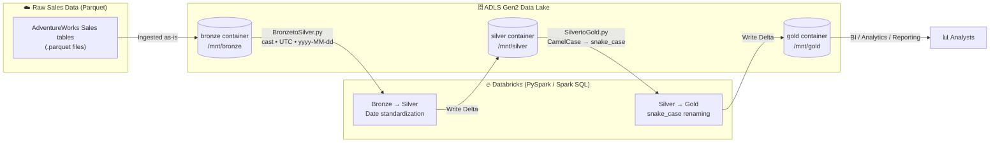
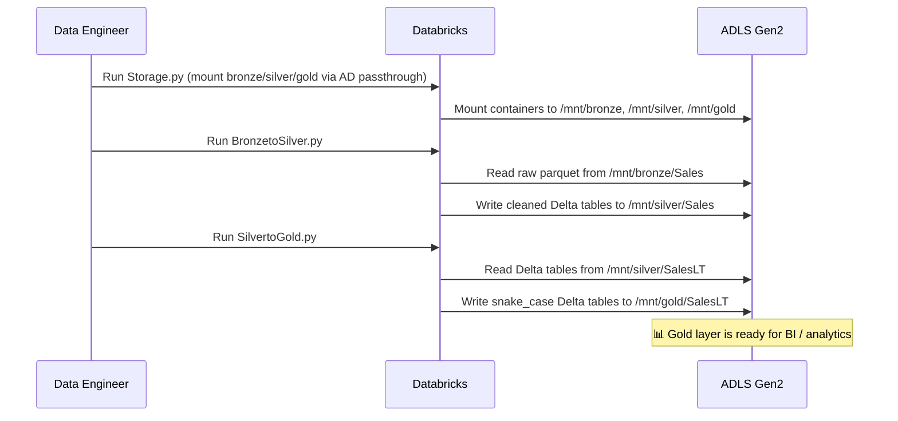

# 🛒 Sales Data Analytics — End-to-End Data Engineering Project

An end-to-end data engineering pipeline built on **Databricks** that ingests raw Sales data (AdventureWorks `Sales` / `SalesLT` tables), cleans and standardizes it, and serves it for analytics using the **Medallion Architecture** (Bronze → Silver → Gold), with each layer stored as **Delta Lake** tables in the cloud data lake.

---

## 📐 Architecture Overview



### The Medallion Architecture at a glance

```
┌─────────────────────────────────────────────────────────────────────┐
│                          MEDALLION ARCHITECTURE                      │
├──────────────────┬──────────────────────┬────────────────────────────┤
│   🥉 BRONZE      │   🥈 SILVER           │   🥇 GOLD                  │
│  (Raw / as-is)   │  (Cleaned / std.)    │  (Business-ready)          │
├──────────────────┼──────────────────────┼────────────────────────────┤
│ Raw parquet      │ Delta tables          │ Delta tables               │
│ Sales tables     │ Date columns cast to  │ Columns renamed to        │
│ landed in ADLS   │ timestamp, UTC-aligned│ snake_case convention      │
│ Gen2 bronze      │ & formatted           │ for analytics & reporting  │
│ container        │ yyyy-MM-dd            │                            │
└──────────────────┴──────────────────────┴────────────────────────────┘
```

---

## 📁 Project Structure

```
Sales-Data-Analytics-End-to-End-Data-Engineering-Project/
│
├── ADLS-Storage/
│   └── Storage.py            # Mounts ADLS Gen2 containers to DBFS
│
├── Bronze-to-Silver/
│   └── BronzetoSilver.py     # Bronze → Silver transformation
│
├── Silver-to-Gold/
│   └── SilvertoGold.py       # Silver → Gold transformation
│
└── README/
    └── README.md             # Project documentation (this file)
```

---

## ⚙️ Pipeline Components

### 1️⃣ Cloud Storage Setup — `ADLS-Storage/Storage.py`

The foundation of the pipeline: it mounts the three **Azure Data Lake Storage Gen2** containers (`bronze`, `silver`, `gold`) from the storage account `deprojdatalakegen2` into Databricks DBFS, using **Azure AD credential passthrough** for secure, per-user authentication.

| Mount Point | ADLS Gen2 Source | Purpose |
| --- | --- | --- |
| `/mnt/bronze` | `abfss://bronze@deprojdatalakegen2...` | Raw ingested data |
| `/mnt/silver` | `abfss://silver@deprojdatalakegen2...` | Cleaned & standardized data |
| `/mnt/gold` | `abfss://gold@deprojdatalakegen2...` | Business-ready data |

### 2️⃣ Bronze → Silver Transformation — `Bronze-to-Silver/BronzetoSilver.py`

Reads the raw parquet files for each Sales table from the Bronze layer, **standardizes every date column**, and writes the cleaned data to the Silver layer as **Delta tables** (one per source table).

**Key transformations:**

* 🔍 Auto-discovers all Sales tables in `/mnt/bronze/Sales/` via `dbutils.fs.ls()`
* 📅 For every column whose name contains `"Date"` / `"date"`:
  * Cast to `TimestampType`
  * Align to **UTC** (`from_utc_timestamp`)
  * Format as **`yyyy-MM-dd`** (`date_format`)
* 💾 Writes to `/mnt/silver/Sales/<table>/` as Delta with `mode("overwrite")`

### 3️⃣ Silver → Gold Transformation — `Silver-to-Gold/SilvertoGold.py`

Iterates over all Delta tables in the Silver layer (`SalesLT` schema), renames columns from **CamelCase to snake_case**, and writes the result to the Gold layer — producing analytics-friendly, business-ready tables.

**Key transformations:**

* 🔍 Auto-discovers all tables in `/mnt/silver/SalesLT/` via `dbutils.fs.ls()`
* 🐍 Renames each column, e.g. `SalesOrderID` → `sales_order_id`
* 💾 Writes to `/mnt/gold/SalesLT/<table>/` as Delta with `mode("overwrite")`

---

## 🔄 End-to-End Data Flow



---

## 🧰 Tech Stack

| Component | Technology |
| --- | --- |
| Compute | 🔥 Databricks (PySpark, Spark SQL) |
| Storage | 🗄️ Azure Data Lake Storage Gen2 (Delta Lake format) |
| Table Format | 🔄 Delta Lake (ACID transactions, overwrite mode) |
| Orchestration | ✅ Databricks notebooks (run order: Storage → Bronze→Silver → Silver→Gold) |
| Version Control | 🌿 Git (GitHub) |
| Data Model | 🥇 Medallion Architecture (Bronze / Silver / Gold) |

---

## ▶️ How to Run

1. **Mount the storage** — run `Storage.py` first to mount the `bronze`, `silver`, and `gold` ADLS Gen2 containers to DBFS.
2. **Bronze → Silver** — run `BronzetoSilver.py` to standardize date columns and promote raw Sales tables to the Silver layer.
3. **Silver → Gold** — run `SilvertoGold.py` to rename columns to snake_case and produce the business-ready Gold layer.

> ⚠️ **Note:** The scripts use Azure AD **credential passthrough**, so run them on a Databricks cluster with passthrough enabled, under a user who has access to the `deprojdatalakegen2` storage account.

---

## 🎯 Key Takeaways

* Implements the **Medallion Architecture** — a proven, layered approach to building a reliable lakehouse.
* Uses **Delta Lake** at every layer for ACID transactions and schema reliability.
* Pipelines are **table-driven** — new tables dropped into Bronze/Silver are picked up automatically.
* Produces a **clean, snake_case Gold layer** that is directly consumable by BI tools and downstream analytics.
